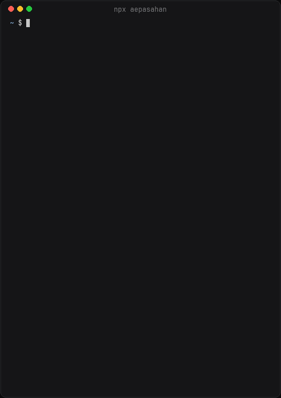

<div align="center">

# termcard

**Your business card, in the terminal.**

Created by [Ahmet Erkan Paşahan](https://aepasahan.com)

[](https://www.npmjs.com/package/termcard)
[](https://github.com/aepasahan/termcard/actions/workflows/ci.yml)
[](LICENSE)
[](https://nodejs.org)
[](https://developer.mozilla.org/docs/Web/JavaScript/Guide/Modules)
[](packages/termcard/package.json)
[](#requirements)



</div>

## What is it?

Developers and designers spend their day in the terminal, so why not meet them there?
termcard turns a short description of who you are into a small interactive program that
anyone can open with one command:

```bash
npx yourname
```

Your visitor sees a clean business card and a menu. With a few keystrokes they can write
you an email, save you to their contacts, open your website and profiles, or switch the
card to their own language. Nothing to install, nothing to sign up for.

Creating your own takes about two minutes and no code:

```bash
npm create termcard@latest
```

A short wizard asks for your details, shows a live preview, checks that your name is free
on npm and publishes the card for you.

## What your visitors can do

- **Get in touch** — opens a new email to you in their mail app
- **Save contact** — adds your vCard to their address book
- **Visit your website and profiles** — LinkedIn, GitHub, X, Behance, Dribbble and more
- **Copy your email or phone number** to the clipboard
- **Switch language** — the card follows their system language and can be changed from the menu

## Features

- **No code to fork or edit.** Your card is a single, validated JSON file.
- **Five languages built in** — English, Turkish, German, Spanish and French — and you can add your own.
- **Eight seasonal color themes**, from *thaw* to *midwinter*, designed to look calm on both dark and light terminals.
- **Three layouts, optional icons and a short description**; choose which details appear, in what order, or show only the menu.
- **Updates reach everyone.** Cards depend on termcard, so improvements arrive without republishing your card.
- **Private and safe by design.** Zero dependencies, no tracking, and every value in a card is validated and sanitized before it reaches anyone's terminal.

## Customizing your card

Everything lives in `card.config.json`. Only your name is required:

```json
{
  "name": "Jane Doe",
  "tagline": "@studio",
  "email": "jane@example.com",
  "website": "https://jane.example.com",
  "links": ["https://www.linkedin.com/in/janedoe", "https://github.com/janedoe"],
  "language": { "available": ["en", "de"] },
  "theme": "frost",
  "icons": "symbols"
}
```

The [configuration guide](docs/configuration.md) covers every option, and
[`examples/full.json`](examples/full.json) shows them all together.

## Command line

termcard also ships a small tool for card owners. Visitors never see or need it.

| Command | What it does |
| ------- | ------------ |
| `npx termcard preview` | Opens your card locally, exactly as visitors will see it. |
| `npx termcard validate` | Checks your config and explains any mistakes. |
| `npx termcard build` | Optional. Exports your card for use outside the terminal: a web page, vCards and plain-text versions, plus ready-made code so that `curl yourdomain.com` prints your card. |

## Requirements

Node.js 18.18 or newer on macOS, Linux or Windows. Visitors need nothing but `npx`, which
comes with Node.js.

## Project

This repository contains two packages:

| Package | |
| ------- | --- |
| [`termcard`](packages/termcard) | Renders and runs the cards. Every card depends on it. |
| [`create-termcard`](packages/create-termcard) | The setup wizard behind `npm create termcard`. |

Contributions are welcome — see [CONTRIBUTING.md](CONTRIBUTING.md). Please report
security issues privately as described in [SECURITY.md](SECURITY.md). How termcard handles
personal data is described in [PRIVACY.md](PRIVACY.md).

---

<div align="center">

Designed and built by **[Ahmet Erkan Paşahan](https://aepasahan.com)** ·
[LinkedIn](https://www.linkedin.com/in/aepasahan) · [GitHub](https://github.com/aepasahan) ·
try it: `npx aepasahan`

Released under the [MIT License](LICENSE).

</div>
